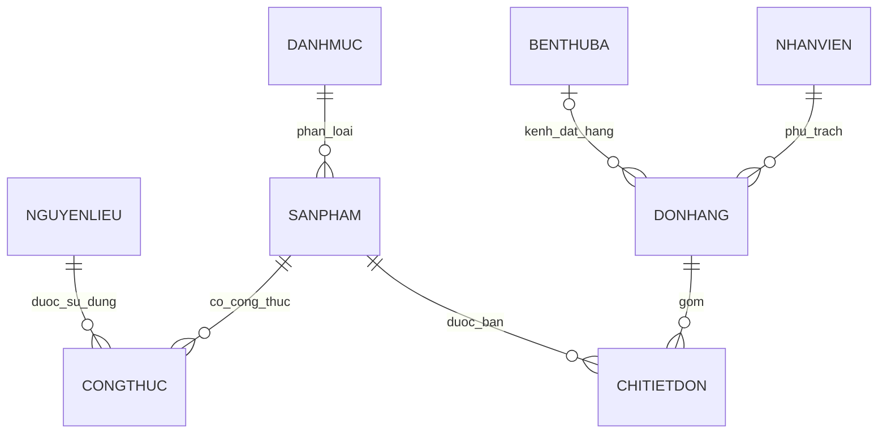

# Quản lý quán cà phê – Đồ án OOP cuối kỳ

**Ứng dụng Java 21, quản lý và thống kê dữ liệu quán cà phê bằng SQLite.
** Dự án sử dụng Maven để quản lý thư viện và JDBC để đọc dữ liệu từ cơ sở dữ liệu SQLite được đóng gói sẵn trong project.

## 1. Phát biểu vấn đề

Hệ thống được xây dựng nhằm mô phỏng việc quản lý dữ liệu của một quán cà phê và thực hiện 30 câu truy vấn phục vụ thống kê hoạt động kinh doanh. Các nghiệp vụ gồm quản lý danh mục và sản phẩm, nguyên liệu và công thức pha chế, đơn hàng, nhân viên, phương thức thanh toán, nền tảng đặt hàng bên thứ ba, doanh thu và chi phí nguyên liệu.

Ứng dụng có giao diện JavaFX. Người dùng chọn một câu truy vấn trong danh sách, nhập hoặc chọn tham số khi cần, nhấn **Chạy** và xem kết quả trong bảng.

## 2. Công nghệ sử dụng

- **Java 21** – ngôn ngữ lập trình.
- **JavaFX 21** – xây dựng giao diện đồ họa.
- **Maven** – quản lý phụ thuộc và cấu hình biên dịch.
- **SQLite** – lưu trữ dữ liệu mẫu trong file `quan_cafe.db`.
- **SQLite JDBC** – kết nối Java với SQLite.
- **IntelliJ IDEA** – môi trường phát triển được khuyến nghị.

> **Lưu ý:** Phiên bản trong ZIP này là dự án JavaFX + SQLite. Dự án không dùng MySQL, SQL Server hoặc C# và không cần cài máy chủ cơ sở dữ liệu riêng để chạy dữ liệu mẫu.

## 3. Cách mở và chạy trong IntelliJ IDEA

> **Lỗi cần sửa trước khi chạy bản ZIP hiện tại:** Trong `App.java`, phần Câu 5 đang gán kết quả `ql.tongTienDon(maDon)` vào biến kiểu `DonHang`, nhưng phương thức `tongTienDon()` trong `QuanLyCafe.java` trả về `Long`. Hai kiểu dữ liệu này không tương thích nên project sẽ báo lỗi biên dịch. Vì Câu 5 cần lấy thông tin đơn và các dòng chi tiết, hãy đổi dòng:
>
> ```java
> DonHang don = ql.tongTienDon(maDon);
> ```
>
> thành:
>
> ```java
> DonHang don = ql.xemChiTietDon(maDon);
> ```
>
> Sau khi sửa dòng trên, tiếp tục các bước mở và chạy project bên dưới.

1. Giải nén `Do-an-OOP-main.zip` vào một thư mục trên máy.
2. Mở IntelliJ IDEA, chọn **File → Open**, rồi chọn file `pom.xml` trong thư mục `Do-an-OOP-main` để mở project Maven.
3. Cài và chọn **JDK 21** tại **File → Project Structure → Project → SDK**. Cần JDK 21, không chỉ JRE.
4. Chờ IntelliJ tải các thư viện Maven. Nếu cần, mở cửa sổ Maven và chọn **Reload All Maven Projects**.
5. Kiểm tra file dữ liệu `src/main/resources/quan_cafe.db` vẫn có trong project.
6. Mở `src/main/java/App.java`.
7. Nhấn biểu tượng tam giác cạnh phương thức `main()` hoặc chọn **Run 'App.main()'**.
8. Khi cửa sổ **Quản lý quán cà phê - 30 câu truy vấn** xuất hiện, chọn câu truy vấn ở danh sách bên trái. Điền hoặc chọn tham số nếu câu hỏi yêu cầu, sau đó nhấn **Chạy** để xem kết quả.

Nếu không thấy nút **Run**, hãy kiểm tra Project SDK đã chọn JDK 21 chưa, tải lại project Maven và bảo đảm thư mục `src/main/java` được IntelliJ nhận diện là thư mục mã nguồn.

### Chạy thử bằng Maven

Có thể kiểm tra quá trình biên dịch bằng lệnh sau tại thư mục có `pom.xml`:

```bash
mvn clean compile
```

Để mở giao diện ứng dụng, cách được khuyến nghị trong cấu hình hiện tại là chạy `App.java` từ IntelliJ IDEA.

## 4. Cấu trúc project

```text
Do-an-OOP-main/
├── pom.xml
├── README.md
└── src/
    └── main/
        ├── java/
        │   ├── App.java
        │   ├── QuanLyCafe.java
        │   ├── Database.java
        │   ├── DatabaseLoader.java
        │   ├── DanhMuc.java
        │   ├── SanPham.java
        │   ├── NguyenLieu.java
        │   ├── CongThuc.java
        │   ├── DonHang.java
        │   ├── ChiTietDon.java
        │   ├── NhanVien.java
        │   ├── BenThuBa.java
        │   ├── TrangThaiDon.java
        │   └── PhuongThucTT.java
        └── resources/
            └── quan_cafe.db
```

### Vai trò các file chính

- `App.java`: điểm bắt đầu của ứng dụng JavaFX; hiển thị danh sách 30 câu truy vấn, các ô tham số và bảng kết quả.
- `QuanLyCafe.java`: chứa các phương thức xử lý nghiệp vụ và thực hiện các câu truy vấn trên dữ liệu đã nạp.
- `Database.java`: tạo kết nối JDBC đến SQLite và chuẩn bị file cơ sở dữ liệu để sử dụng.
- `DatabaseLoader.java`: đọc dữ liệu từ SQLite, khởi tạo các đối tượng Java và liên kết chúng với nhau theo mã định danh.
- `DanhMuc.java`: thông tin danh mục sản phẩm.
- `SanPham.java`: thông tin sản phẩm, lượng đường, giá bán và công thức nguyên liệu.
- `NguyenLieu.java`: thông tin nguyên liệu, đơn vị, giá nhập, tồn kho và mức tồn tối thiểu.
- `CongThuc.java`: liên kết sản phẩm với nguyên liệu và định lượng sử dụng.
- `DonHang.java`: thông tin đơn hàng, nhân viên, trạng thái, phương thức thanh toán, nền tảng đặt hàng và phụ phí bao bì.
- `ChiTietDon.java`: thông tin từng sản phẩm trong đơn hàng, số lượng, đơn giá và thành tiền.
- `NhanVien.java`: thông tin nhân viên.
- `BenThuBa.java`: thông tin nền tảng đặt hàng bên thứ ba và tỷ lệ chiết khấu.
- `TrangThaiDon.java`: các trạng thái đơn hàng được định nghĩa trong chương trình.
- `PhuongThucTT.java`: các phương thức thanh toán được định nghĩa trong chương trình.
- `pom.xml`: khai báo phiên bản Java và các thư viện cần thiết.
- `src/main/resources/quan_cafe.db`: cơ sở dữ liệu SQLite chứa dữ liệu mẫu.

## 5. Quy tắc nghiệp vụ chính

- Mỗi sản phẩm thuộc một danh mục.
- Một sản phẩm có công thức gồm các nguyên liệu và định lượng tương ứng; một nguyên liệu có thể được dùng trong nhiều sản phẩm.
- Nguyên liệu được cảnh báo khi tồn kho không đủ làm một phần sản phẩm hoặc khi tồn kho chạm/ngang mức tồn tối thiểu.
- Giá vốn sản phẩm được tính bằng tổng định lượng từng nguyên liệu nhân với giá nhập của nguyên liệu đó.
- Lợi nhuận theo cách tính của đồ án bằng giá bán trừ giá vốn nguyên liệu.
- Một đơn hàng có thể chứa nhiều sản phẩm thông qua các dòng chi tiết đơn hàng.
- Thành tiền của một dòng chi tiết bằng số lượng nhân đơn giá. Tổng tiền đơn hàng bằng tổng thành tiền các dòng cộng phụ phí bao bì.
- Đơn hàng có thể bán trực tiếp tại quán hoặc thông qua một nền tảng bên thứ ba. Đơn không gắn nền tảng bên thứ ba được xem là đơn tại quán.
- Các nền tảng bên thứ ba có tỷ lệ chiết khấu; chương trình dùng tỷ lệ này để tính khoản chiết khấu của đơn.
- Phương thức thanh toán gồm tiền mặt và chuyển khoản.
- Trong phiên bản hiện tại, trạng thái đơn hàng được xử lý gồm **hoàn thành** và **đã hủy**. Những thống kê doanh thu ghi rõ là đơn hoàn thành chỉ tính các đơn có trạng thái hoàn thành.
- Ly nhựa được thống kê như một nguyên liệu có tên `Ly nhua` trong công thức của sản phẩm.

## 6. Cơ sở dữ liệu và các thực thể

Dữ liệu được lưu trong SQLite, ở file `src/main/resources/quan_cafe.db`. Các bảng hiện có trong cơ sở dữ liệu gồm:

| Bảng | Mục đích |
|---|---|
| `DanhMuc` | Lưu mã và tên danh mục sản phẩm. |
| `SanPham` | Lưu tên sản phẩm, giá bán, lượng đường và mã danh mục. |
| `NguyenLieu` | Lưu tên nguyên liệu, đơn vị, giá nhập, tồn kho và mức tồn tối thiểu. |
| `CongThuc` | Lưu liên kết giữa sản phẩm và nguyên liệu cùng định lượng sử dụng. |
| `DonHang` | Lưu thời gian, nhân viên, trạng thái, phương thức thanh toán, nền tảng bên thứ ba và phụ phí bao bì. |
| `ChiTietDon` | Lưu sản phẩm, số lượng và đơn giá trong từng đơn hàng. |
| `NhanVien` | Lưu mã và tên nhân viên. |
| `BenThuBa` | Lưu tên nền tảng bên thứ ba và tỷ lệ chiết khấu. |

`TrangThaiDon` và `PhuongThucTT` là enum trong Java, không phải các bảng riêng trong cơ sở dữ liệu. Ly nhựa được biểu diễn qua dữ liệu nguyên liệu/công thức, không phải một bảng độc lập trong phiên bản này.

### Mối quan hệ chính

- Một danh mục có nhiều sản phẩm.
- Sản phẩm và nguyên liệu có quan hệ nhiều-nhiều thông qua bảng `CongThuc`.
- Một đơn hàng có nhiều dòng chi tiết; mỗi dòng chi tiết tham chiếu đến một sản phẩm.
- Một nhân viên có thể phụ trách nhiều đơn hàng; mỗi đơn hàng gắn với một nhân viên.
- Một nền tảng bên thứ ba có thể nhận nhiều đơn hàng; một đơn hàng có thể không gắn nền tảng bên thứ ba nếu bán trực tiếp tại quán.



### Dữ liệu mẫu

Cơ sở dữ liệu đi kèm ZIP hiện có 6 danh mục, 20 sản phẩm, 22 nguyên liệu, 5 nhân viên, 3 nền tảng bên thứ ba và 636 đơn hàng. Dữ liệu đơn hàng có thời gian từ ngày 01/07/2026 đến ngày 30/09/2026.

Một số sản phẩm mẫu gồm cà phê sữa đá, bạc xỉu, Americano, trà đào cam sả, trà sữa và bánh; các nền tảng bên thứ ba gồm GrabFood, ShopeeFood và beFood.

### Lưu ý về dữ liệu

Khi khởi động, `Database.java` sao chép cơ sở dữ liệu đóng gói trong resources sang một file tạm để ứng dụng đọc. Vì vậy, ứng dụng sử dụng dữ liệu mẫu được đóng gói; thay đổi trực tiếp file tạm trong lúc chạy không được giữ lại sau khi chương trình kết thúc.

## 7. Danh sách 30 câu truy vấn

Danh sách dưới đây giữ nguyên số câu trong chương trình. Các phần việc được chia theo ghi chú trong mã nguồn.

### Phần của Nam – câu 1, 2, 12, 13, 18, 20, 24, 26, 27, 28

- **Câu 1:** Liệt kê sản phẩm.
- **Câu 2:** Tìm sản phẩm có nguyên liệu đã hết hoặc sắp hết.
- **Câu 12:** Liệt kê các món thuộc một danh mục được chọn.
- **Câu 13:** Tìm sản phẩm có lợi nhuận cao nhất.
- **Câu 18:** Liệt kê nguyên liệu và định lượng cần để tạo ra một sản phẩm.
- **Câu 20:** Tìm sản phẩm có lượng đường lớn hơn mức được chọn.
- **Câu 24:** Tính giá vốn nguyên liệu và lợi nhuận của từng sản phẩm.
- **Câu 26:** Tra cứu giá nhập của một nguyên liệu cụ thể.
- **Câu 27:** Tìm nguyên liệu có giá nhập cao nhất.
- **Câu 28:** Tìm nguyên liệu có mức tiêu hao trung bình mỗi ngày cao nhất.

### Phần của Minh – câu 3, 4, 5, 6, 7, 11, 14, 17, 19, 30

- **Câu 3:** Lọc các đơn hoàn thành trong một tháng cụ thể.
- **Câu 4:** Xem thông tin và chi tiết của một đơn hàng.
- **Câu 5:** Tính tổng tiền của một đơn hàng.
- **Câu 6:** Thống kê doanh thu của các đơn hoàn thành theo ngày.
- **Câu 7:** Thống kê doanh thu theo tháng.
- **Câu 11:** Tìm các đơn có giá trị lớn nhất, nhỏ nhất hoặc trên mức trung bình.
- **Câu 14:** Tìm hóa đơn có tổng số sản phẩm lớn hơn một số lượng được chọn.
- **Câu 17:** Tìm ngày có doanh thu cao nhất.
- **Câu 19:** Tìm hóa đơn có giá trị lớn hơn một số tiền được chọn.
- **Câu 30:** Liệt kê các đơn đã hủy trong một ngày được chọn.

### Phần của Hưng – câu 8, 9, 10, 15, 16, 21, 22, 23, 25, 29

- **Câu 8:** Tìm 5 sản phẩm bán nhiều nhất trong một tháng.
- **Câu 9:** Tìm sản phẩm chưa được bán trong ngày được chọn (không xuất hiện trong đơn hoàn thành của ngày đó).
- **Câu 10:** Thống kê số đơn và doanh thu của từng nhân viên.
- **Câu 15:** Lọc các đơn theo phương thức thanh toán tiền mặt hoặc chuyển khoản.
- **Câu 16:** Thống kê doanh thu của từng nhân viên theo ngày.
- **Câu 21:** Lọc các đơn qua bên thứ ba có phụ phí bao bì.
- **Câu 22:** Tính tổng chiết khấu của từng nền tảng bên thứ ba.
- **Câu 23:** Thống kê số ly nhựa đã sử dụng trong các đơn hoàn thành.
- **Câu 25:** Tìm nền tảng bên thứ ba có nhiều đơn hoàn thành nhất.
- **Câu 29:** Tìm khung giờ có số lượng sản phẩm bán ra cao nhất.

## 8. Trình tự demo gợi ý

Ngày demo theo dữ liệu mẫu: **23/09/2026**.

1. **Câu 1:** Hiển thị danh sách sản phẩm.
2. **Câu 2:** Kiểm tra và hiển thị cảnh báo nguyên liệu.
3. **Câu 3:** Lọc các đơn hoàn thành trong tháng 09/2026.
4. **Câu 4:** Nhập mã đơn **10** để xem thông tin đơn hàng mẫu có trong cơ sở dữ liệu.
5. **Câu 5:** Xem tổng tiền và chi tiết của đơn hàng đã chọn.
6. **Câu 6:** Chọn ngày 23/09/2026 để xem doanh thu theo ngày.
7. **Câu 7:** Thống kê doanh thu theo tháng.
8. **Câu 8:** Tìm 5 sản phẩm bán nhiều nhất trong tháng 09/2026.
9. **Câu 9:** Tìm các sản phẩm chưa được bán trong ngày 23/09/2026.
10. **Câu 10:** Thống kê số đơn và doanh thu của từng nhân viên.
11. **Câu 11:** Minh họa các đơn có giá trị lớn nhất, nhỏ nhất hoặc trên trung bình.
12. **Câu 12:** Chọn danh mục để liệt kê các món thuộc danh mục đó.
13. **Câu 13:** Tìm sản phẩm có lợi nhuận cao nhất.
14. **Câu 14:** Nhập ngưỡng số lượng sản phẩm cần lọc.
15. **Câu 15:** Lọc đơn theo phương thức thanh toán.
16. **Câu 16:** Chọn ngày để xem doanh thu của từng nhân viên.
17. **Câu 17:** Tìm ngày có doanh thu cao nhất.
18. **Câu 18:** Chọn một sản phẩm để xem nguyên liệu và định lượng cần dùng.
19. **Câu 19:** Nhập ngưỡng tiền cần lọc hóa đơn.
20. **Câu 20:** Nhập mức đường để tìm các sản phẩm có lượng đường cao hơn mức đó.
21. **Câu 21:** Tìm đơn qua bên thứ ba có phát sinh phụ phí bao bì.
22. **Câu 22:** Thống kê tổng chiết khấu theo nền tảng bên thứ ba.
23. **Câu 23:** Thống kê số ly nhựa đã sử dụng.
24. **Câu 24:** Tính giá vốn nguyên liệu của từng sản phẩm.
25. **Câu 25:** Tìm nền tảng bên thứ ba có nhiều đơn hoàn thành nhất.
26. **Câu 26:** Chọn nguyên liệu để xem giá nhập.
27. **Câu 27:** Tìm nguyên liệu có giá nhập cao nhất.
28. **Câu 28:** Tìm nguyên liệu có mức tiêu hao trung bình mỗi ngày cao nhất.
29. **Câu 29:** Tìm khung giờ bán được nhiều sản phẩm nhất.
30. **Câu 30:** Lọc các đơn đã hủy trong ngày 23/09/2026.

> Các câu có tham số cho phép chỉnh ngày, tháng, mã sản phẩm/nguyên liệu hoặc ngưỡng lọc ngay trên giao diện. Nên kiểm tra tham số trước khi nhấn **Chạy**.
